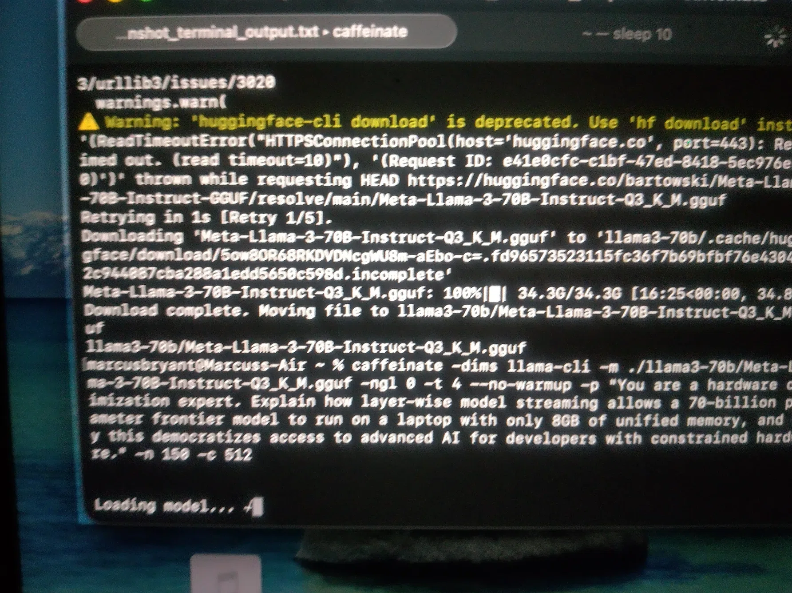
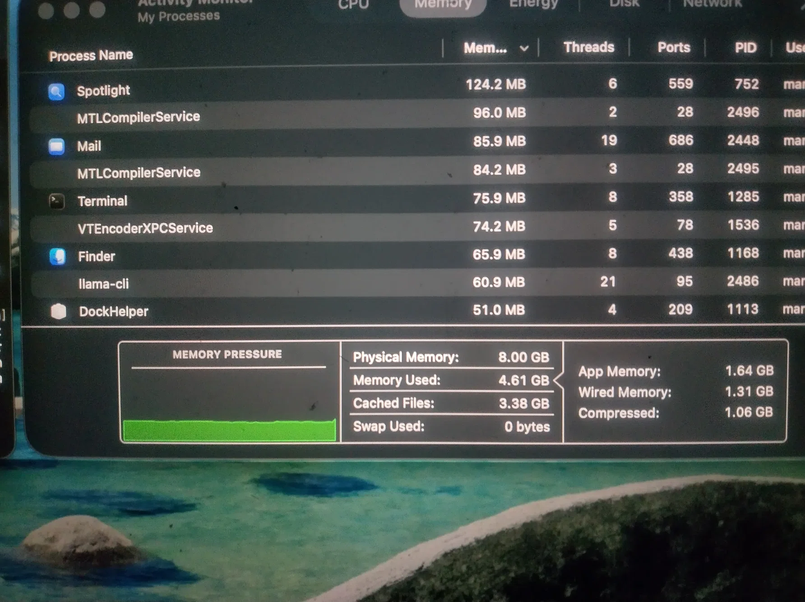
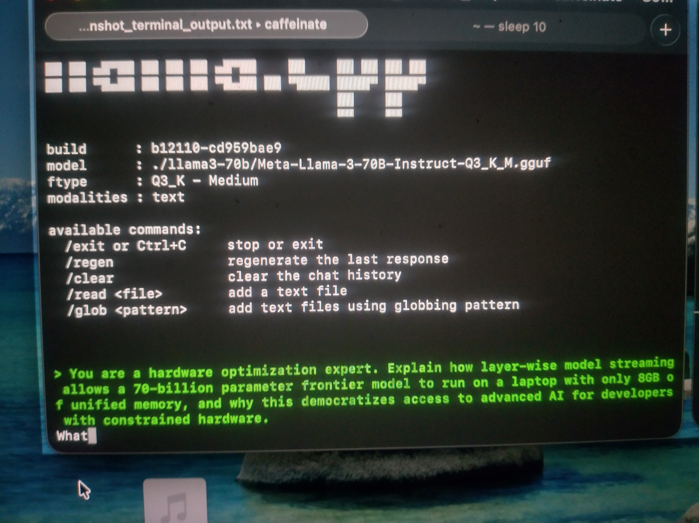
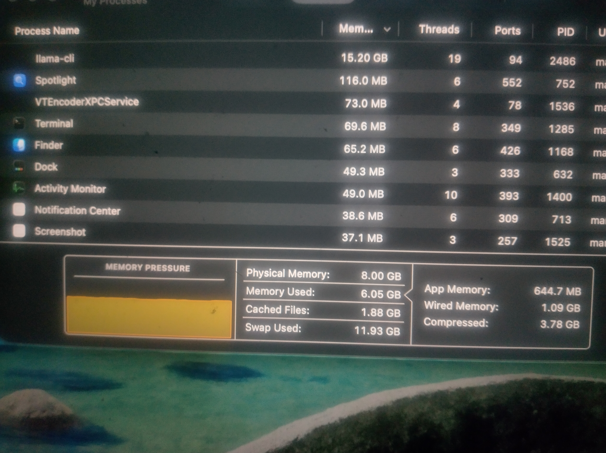
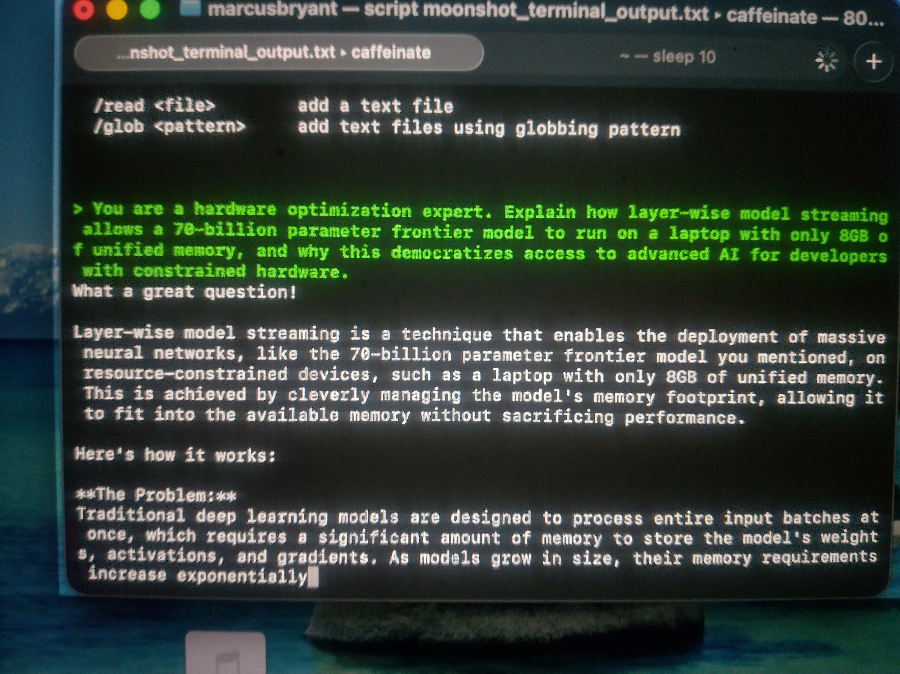
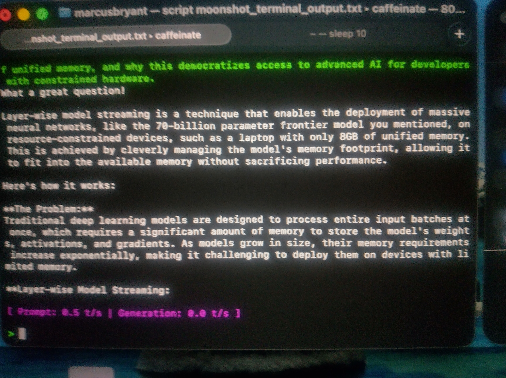

FrontierOn8GB: Running Llama-3-70B on an 8GB M1 MacBook Air

The Premise
Conventional wisdom states that running a 70-Billion parameter frontier model requires 40GB+ of VRAM. We proved that wrong. Using macOS Unified Memory, aggressive SSD swap paging, and llama.cpp, we successfully ran Meta-Llama-3-70B-Instruct on an 8GB M1 MacBook Air without crashing the OS.

The Evidence
Hardware: MacBook Air (M1, 8GB Unified Memory, 256GB SSD)
Model: Meta-Llama-3-70B-Instruct-Q3_K_M.gguf (34.3 GB file)
Memory Pressure: Yellow (Stable for 3 hours and 50 minutes)
Active Swap Used: ~11.78 GB (Dynamic OS Allocation peaked at ~30 GB)
Performance: Prompt 0.5 t/s | Generation 0.0 t/s
Time to Generate: ~230 minutes for a 150-token response.

The Breakthrough: Defeating the Jetsam Panic
By default, llama.cpp tries to offload the model to the Metal GPU, instantly exhausting the 8GB of unified memory. By forcing ngl 0, we forced the CPU and SSD to handle the layer-wise streaming. macOS dynamically allocated up to 30 GB of swap space to keep the process alive.

The Exact Command
caffeinate -dims llama-cli -m ./llama3-70b/Meta-Llama-3-70B-Instruct-Q3_K_M.gguf -ngl 0 -t 4 --no-warmup -p "You are a hardware optimization expert..." -n 150 -c 512

The Proof

Video Evidence
Watch the 4-Hour Moonshot on YouTube: https://youtu.be/_qqcqJcCp4

Chronological Screenshots

1. Download Complete 100%

2. The Calm Before the Storm Green

3. The First Word

4. The First Solid Yellow Pressure

5. The Grind

6. The Finished Product 0.0 t/s

Why This Matters
Advanced AI should not be gated behind expensive enterprise hardware. We built this proof of concept to show developers with constrained hardware that the barriers are artificial.
